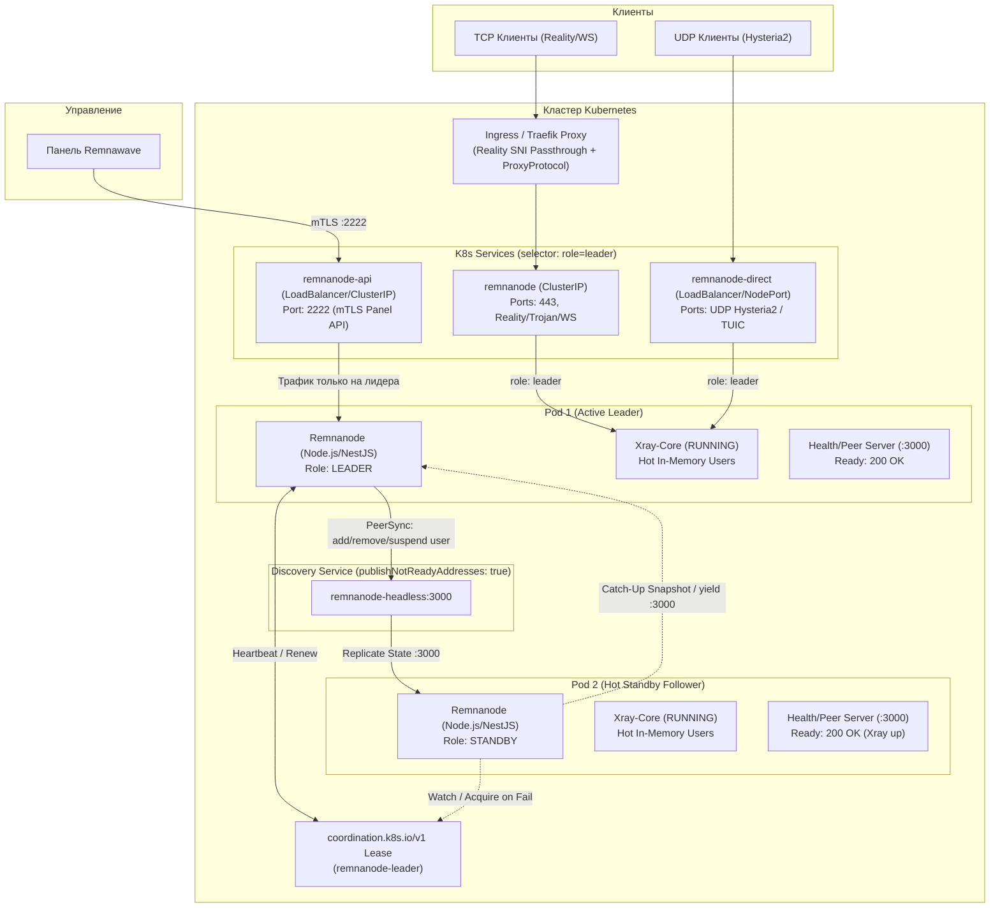

# Remnawave Node (Cloud-Native Kubernetes HA Edition)

> Высокодоступный (Active-Passive / Hot-Standby) форк-патч официального узла [Remnawave Node](https://github.com/remnawave/node), оптимизированный для работы в Kubernetes без использования `hostNetwork` и без привилегированных прав хоста (`CAP_NET_ADMIN`).

[](package.json)
[](https://github.com/remnawave/node)
[](LICENCE)
[](charts/remnanode)

---

## 📖 О проекте

Оригинальный [Remnawave Node](https://github.com/remnawave/node) предназначен для одиночного развертывания на физических серверах или VPS в Docker с параметрами `network_mode: host` и системными привилегиями `cap_add: [NET_ADMIN]`. 

При попытке запуска оригинального узла в современном Kubernetes-кластере возникают критические архитектурные ограничения:
1. **Конфликты портов и блокировок**: Флаг `network_mode: host` и абстрактный UNIX-сокет (`\0rwnode-lock`) делают невозможным запуск более одной реплики на одной ноде кластера.
2. **Неработоспособность защиты от торрентов за Reverse Proxy (Traefik/Ingress)**: Оригинальный узел блокирует IP нарушителей через `nftables` хоста. В облачной топологии с Ingress/Traefik и PROXY protocol IP-пакеты в Pod NetNS имеют адрес прокси (`src_ip = Traefik_IP`), из-за чего блокировка по IP приводила к бану самого Ingress-контроллера и отключению всех пользователей.
3. **Холодный старт и потеря сессий**: Панель Remnawave регистрирует пользователей в оперативной памяти Xray-core на лету по mTLS. При холодном старте резервной ноды чтение и инициализация тысяч пользователей занимали существенное время, вызывая ощутимый даунтайм.

**Remnawave Node Cloud-Native HA** устраняет эти проблемы, превращая узел в полноценное облачное приложение с динамическим распределением ролей, синхронизацией горячего резерва и бесшовным обновлением без потери трафика.

---

## 🏛 Архитектура решения



---

## 📊 Сравнение: Оригинал vs Cloud-Native HA Patch

| Характеристика | Оригинальный `remnawave/node` | Cloud-Native HA Patch (`remnawave-node-cloud-native`) |
| :--- | :--- | :--- |
| **Режим запуска** | Одиночный контейнер (Standalone), 1 инстанс | **Active-Passive (Hot-Standby)** с K8s Leader Election |
| **Сетевая изоляция** | `network_mode: host` (конфликт портов при масштабировании) | **Изолированный Pod NetNS** (`hostNetwork: false`), без коллизий |
| **Лок инстанса** | Монопольный абстрактный UNIX-сокет (`\0rwnode-lock`) | Флаг `DISABLE_INSTANCE_LOCK` для параллельного запуска реплик |
| **Синхронизация ключей** | Отсутствует (пользователи живут только в памяти 1 ноды) | **`PeerSyncService`**: репликация в реальном времени + Catch-up снимок |
| **Готовность к фейловеру**| Холодный старт (простой сервиса при сбое) | **Hot-Standby**: Xray запущен на всех репликах, переключение за ~50-100 мс |
| **Блокировка торрентов** | Ядро хоста (`nftables-napi` + `sockdestroy` + `CAP_NET_ADMIN`) | **`UserSuspensionService`**: прикладная блокировка в Xray по userId без привилегий |
| **Совместимость с Ingress**| Ломается (блокировка по IP в nftables банит сам Traefik) | Полная совместимость с Traefik / IngressRoute / Proxy Protocol v2 |
| **Обновление подов** | Даунтайм при рестарте контейнера | **Graceful Handoff (`yieldLeadership`)** с 10-секундным наложением трафика |
| **Деплой** | docker-compose на VPS | Полнофункциональный **Helm-чарт** (RBAC, Ingress, Cron, Sidecars, Cilium) |

---

## 🚀 Что сделано в патче

### 1. K8s Leader Election & Динамическая маркировка подов
- Встроен легковесный клиент координации на базе стандартного API Kubernetes `coordination.k8s.io/v1 Lease` (модуль `LeaderElectionService`). Никаких внешних баз данных, etcd или sidecar-контейнеров не требуется.
- **Dynamic Role Labeling**: Под-лидер автоматически назначает себе лейбл `role: leader`, а резервный — `role: standby` через вызовы K8s API.
- Сервисы кластера (`remnanode-api`, `remnanode`, `remnanode-direct`) используют селектор `role: leader`, направляя клиентские прокси-соединения и вызовы Панели исключительно на активного лидера.

### 2. Архитектура «Горячего резерва» (Hot-Standby) и `PeerSyncService`
- Процесс Xray-core **запущен одновременно на всех репликах** (лидере и фолловерах).
- **Репликация в реальном времени**: При поступлении команд от Панели на лидера (`POST /xray/start`, `addUser`, `removeUser`, `suspendUser` и др.) лидер синхронно применяет их у себя и асинхронно реплицирует на Standby-поды через K8s Headless Service (`publishNotReadyAddresses: true`).
- **Catch-up Sync**: При запуске нового пода он обращается к эндпоинту `/internal/peer-sync/snapshot` лидера, выкачивает актуальную конфигурацию Xray и весь пул пользователей, после чего переходит в статус горячего резерва.
- В случае падения лидера резервный под готов принимать трафик мгновенно: **0 мс задержки на запуск Xray и загрузку ключей**.

### 3. Бесшовный Rollout Restart (Zero-Downtime Handoff)
- При плановом обновлении версии или манифестов (`kubectl rollout restart` / Helm upgrade):
  1. K8s поднимает новый под согласно стратегии `maxSurge: 1, maxUnavailable: 0`.
  2. Новый под выполняет Catch-up синхронизацию с лидером и запускает локальный Xray.
  3. После успешного прохождения проверки здоровья новый под отправляет старому лидеру запрос на мягкую передачу полномочий (`yieldLeadership`).
  4. Старый лидер освобождает K8s Lease, предотвращает повторный захват на 20 секунд и входит в **10-секундный режим дренажа (`isDrainingState`)**.
  5. В течение этих 10 секунд старый лидер сохраняет лейбл `role: leader` и readiness `200 OK`. Оба пода одновременно присутствуют в эндпоинтах K8s, гарантируя завершение существующих пользовательских сессий и плавное переключение новых соединений.

### 4. Самоисцеление и защита от аварий (Crash & OOM Gates)
- **`canAcquireLeadership` gate**: Предотвращает захват лидерства подом, чей локальный Xray еще не готов (исключает перехват трафика неготовым контейнером).
- **`checkLeaderXrayHealth`**: Если процесс Xray на лидере аварийно завершился или был убит ядром (OOMKilled), в то время как Node.js остался жив:
  - Лидер детектирует отказ локального Xray.
  - Если стендбай-нода здорова, лидер немедленно слагает полномочия, снимает лейбл и отправляет стендбаю команду на внеочередной промоушен (`/internal/leader/promote`).
- **`demoteStaleLeaderLabel`**: При аварийной смерти пода без корректного завершения (SIGKILL / сбой хоста) новый лидер принудительно очищает устаревший лейбл `role: leader` со старого пода.

### 5. Прикладная блокировка торрентов (`UserSuspensionService`)
- Полностью исключены небезопасные зависимости от `hostNetwork`, `CAP_NET_ADMIN` и `nftables-napi`.
- Реализован прикладной сервис `UserSuspensionService`: при фиксации BitTorrent-трафика встроенным вебхуком Xray модуль определяет `userId` (UUID/Email) нарушителя и временно отключает его от активных inbound-шлюзов Xray через XTLS API (`removeUser`).
- Таймер блокировки и снятие бана синхронизируются по всей цепочке реплик через `PeerSync`.
- Безопасно для использования за любыми L4/L7 прокси и балансировщиками (Traefik, Envoy, NGINX).

### 6. Двухпортовая сетевая архитектура
- **`NODE_PORT` (по умолчанию 2222)**: Внешний mTLS-порт с взаимной TLS-аутентификацией для общения с Панелью Remnawave.
- **`HEALTH_PORT` (по умолчанию 3000)**: Внутренний HTTP-сервер, обслуживающий:
  - Пробы Kubernetes: `/health/live` (Liveness) и `/health/ready` (Readiness).
  - Внутренний API репликации: `/internal/peer-sync/apply` и `/internal/peer-sync/snapshot`.
  - Управление жизненным циклом лидерства: `/internal/leader/yield` и `/internal/leader/promote`.
  - Все служебные эндпоинты защищены проверкой заголовка `x-secret-key`.

---

## 🔧 Переменные окружения

| Переменная | По умолчанию | Описание |
| :--- | :--- | :--- |
| `NODE_PORT` | `2222` | Порт mTLS API для взаимодействия с Панелью Remnawave |
| `HEALTH_PORT` | `3000` | Порт внутреннего HTTP-сервера (пробы K8s и PeerSync) |
| `SECRET_KEY` | *Обязательно* | Ключ узла (токен подключения, сгенерированный Панелью) |
| `K8S_LEADER_ELECTION_ENABLED` | `false` | Включение режима K8s Leader Election (`true` для HA в кластере) |
| `K8S_LEASE_NAME` | `remnanode-leader` | Имя K8s Lease ресурса в namespace для координации |
| `PEER_HEADLESS_SERVICE` | `undefined` | FQDN Headless-сервиса кластера для поиска пиров (например, `remnanode-headless.remnanode.svc.cluster.local`) |
| `DISABLE_INSTANCE_LOCK` | `false` | Отключение проверки абстрактного UNIX-сокета (обязательно `true` для K8s) |
| `TRUSTED_PROXIES` | `10.0.0.0/8,...` | Диапазоны доверенных подсетей кластера / прокси |
| `SNI_VERIFICATION` | `false` | Строгая верификация SNI входящих mTLS соединений |

---

## 📦 Развертывание через Helm

В репозитории подготовлен готовый Helm-чарт в папке [`charts/remnanode`](charts/remnanode).

### 1. Подготовка секретов

Создайте Secret с ключом узла из панели:

```bash
kubectl create namespace remnanode
kubectl create secret generic remnanode-secrets \
  --namespace remnanode \
  --from-literal=SECRET_KEY="<ВАШ_SECRET_KEY_ИЗ_ПАНЕЛИ>"
```

### 2. Пример `values.yaml` для HA-установки

```yaml
replicaCount: 2

node:
  apiPort: 2222
  healthPort: 3000
  disableInstanceLock: true
  existingSecret: "remnanode-secrets"
  
  # Пул внешних IP для K3s ServiceLB (если используется)
  service:
    type: LoadBalancer
    externalTrafficPolicy: Local

leaderElection:
  enabled: true
  leaseName: remnanode-leader

peerSync:
  enabled: true

# Определение клиентских входящих портов
inbounds:
  - port: 443
    protocol: tcp
    mode: proxy # Проксируется через Traefik IngressRouteTCP
  - port: 8443
    protocol: udp
    mode: direct # Прямой трафик (Hysteria2) через Service remnanode-direct

geodata:
  enabled: true # Автоматическая загрузка и обновление geoip/geosite сайдкаром
```

### 3. Установка чарта

```bash
helm upgrade --install remnanode ./charts/remnanode \
  --namespace remnanode \
  --values values.yaml
```

---

## 📄 Документация по архитектуре

Подробные проектные решения и спецификации модулей вынесены в директорию [`docs/architecture/`](docs/architecture/):
- [`01-network-and-blocking.md`](docs/architecture/01-network-and-blocking.md) — Сетевая модель, отказ от `CAP_NET_ADMIN` и механизм блокировок.
- [`02-traefik-integration.md`](docs/architecture/02-traefik-integration.md) — Сквозное проксирование Reality (SNI Passthrough) и PROXY protocol.
- [`03-active-passive-leader-election.md`](docs/architecture/03-active-passive-leader-election.md) — Полная спецификация алгоритма Leader Election, K8s Lease и PeerSync.

---

## 👥 Contributors & Upstream

- Исходный проект: [Remnawave Node](https://github.com/remnawave/node)
- Официальная документация Remnawave: [docs.rw](https://docs.rw/)
- Патч и адаптация для Kubernetes: [TheroDev-Corp](https://github.com/TheroDev-Corp)

<p align="center">
  Благодарим контрибьюторов оригинального проекта Remnawave:
</p>
<p align="center">
  <a href="https://github.com/remnawave/node/graphs/contributors">
    
  </a>
</p>
